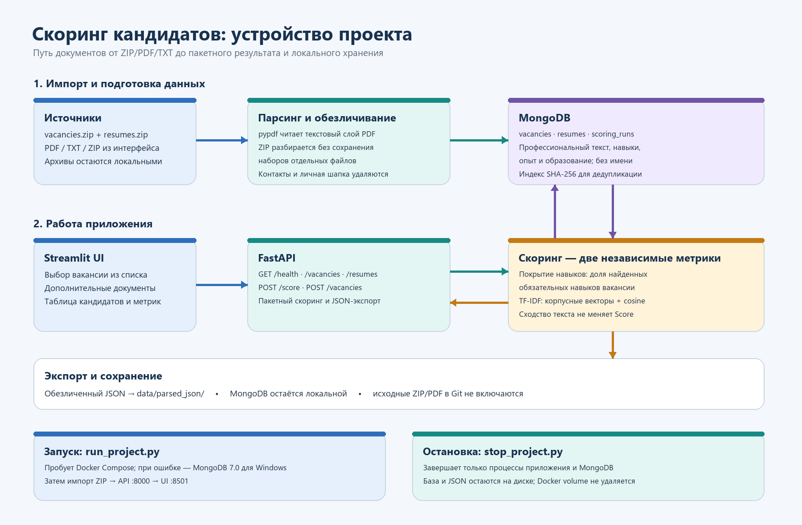

# Что сделано сегодня

**Проект:** система пакетного скоринга кандидатов из PDF/TXT и ZIP. Рабочая копия находится в `A:\CandidateScoringRebuild`, ветка — локальная `main`.

## Что изменено

- Пересобрана структура приложения вокруг отдельных модулей: `Parser/`, `api/`, `db/`, `scorer/`, `ui/`, `tools/`, `tests/`.
- Вместо прежнего хранилища добавлена MongoDB: коллекции `vacancies`, `resumes`, `scoring_runs`; для документов созданы индексы, повторный импорт распознаётся по SHA-256.
- Написан разборщик PDF/TXT вакансий и резюме. ZIP разбирается как набор отдельных документов. Исходное имя файла не попадает в хранилище или JSON.
- В хранилище и JSON-выгрузке остаются поля для скоринга: роль, навыки, опыт, образование и очищенный профессиональный текст. Имя, контакты, точный адрес и сырой текст не экспортируются.
- Добавлен загрузчик `tools/bootstrap_data.py`: при старте он импортирует локальные архивы, обновляет MongoDB и создаёт `data/parsed_json/vacancies.json` и `data/parsed_json/resumes.json`.
- В интерфейсе можно выбрать импортированную вакансию и рассчитать рейтинг всего набора, либо добавить PDF/TXT/ZIP.
- Исправлен TF-IDF: векторы и IDF строятся на общем корпусе вакансий и резюме без повторного учёта уже выбранной вакансии и кандидатов; сравнение выполняется по косинусному сходству. TF-IDF показывается отдельно и не меняет Score покрытия навыков.
- Синтетический Work.ua пакет и связанные с ним файлы удалены. В проект помещены ZIP-архивы, предоставленные пользователем; они исключены из Git.
- Для PyCharm оставлены отдельные Python-файлы запуска и остановки: `run_project.py` и `stop_project.py`. Повреждённый ZIP-документ пропускается, не останавливая весь пакет; стаж и рабочие даты сохраняются в опыте.

## Как проходит обработка

1. `run_project.py` проверяет зависимости и поднимает MongoDB.
2. `tools/bootstrap_data.py` читает `data/vacancies.zip` и `data/resumes.zip`. Поддерживаются PDF с текстовым слоем и TXT; сканированные PDF без OCR пропускаются.
3. `Parser/` извлекает профессиональные поля и удаляет идентифицирующие сведения. Документы без пригодного профессионального текста не добавляются.
4. `db/mongo_store.py` сохраняет обезличенные поля и SHA-256 для предотвращения повторного импорта. Дополнительно формируется обезличенный JSON в `data/parsed_json/`.
5. `ui/app.py` передаёт выбранную вакансию в `api/main.py`.
6. API сопоставляет навыки и отдельно считает корпусное TF-IDF сходство, сохраняет результаты в MongoDB и возвращает таблицу интерфейсу.

**Score навыков** — доля найденных обязательных навыков. **TF-IDF** — отдельный процент текстового сходства; это лексическая метрика, она не понимает семантику как языковая модель. Решение о найме принимает человек.

## MongoDB и Docker

Docker Desktop на этом компьютере продолжал падать при запуске WSL. С разрешения пользователя были сохранены резервные копии двух Docker VHDX и экспорта реестра в `A:\CandidateScoringData\DockerBackup_20261012`, после чего системная WSL-дистрибуция Docker была переинициализирована. Движок после этого всё ещё не стартует.

Чтобы не блокировать проверку приложения, на Windows установлен официальный MongoDB Community Server **7.0.43** вне репозитория. `run_project.py` сначала пытается использовать Docker Compose и при его недоступности запускает локальный `mongod.exe`. Данные этого локального режима сохраняются в `A:\CandidateScoringData\mongo-data-native`. На компьютере с исправным Docker используется Compose и его volume `mongo_data`.

Это два отдельных локальных хранилища. Перенос MongoDB-данных между ними автоматически не выполняется.

## Как запустить и остановить

В PyCharm открыт клон `A:\CandidateScoringRebuild`.

1. Откройте `run_project.py` и нажмите **Run**. Скрипт импортирует архивы, запускает API и интерфейс, затем открывает браузер на `http://127.0.0.1:8501`.
2. Выберите вакансию и нажмите расчёт. Дополнительные файлы загружать не обязательно.
3. Чтобы завершить работу, откройте `stop_project.py` и нажмите **Run**. База и JSON-выгрузки при остановке сохраняются.

Swagger API доступен по адресу `http://127.0.0.1:8000/docs`.

## Что проверено

- Импортированы **55 вакансий** и **195 резюме** из пользовательских архивов; **один PDF пропущен**, потому что в нём не нашлось профессионального текста.
- `GET /health` вернул состояние `ok`; `/vacancies` и `/resumes` вернули 55 и 195 записей.
- UI ответил HTTP 200.
- Эндпоинт скоринга успешно обработал все 195 резюме для вакансии с обязательными навыками.
- Все **12 unit-тестов** прошли. Проверены покрытие навыков, отрицания, обезличивание личных разделов, сохранение дат опыта, отсутствие дублированных TF-IDF-документов, обработка повреждённого ZIP и разбор ZIP.
- После проверки `stop_project.py` остановил UI, API и локальную MongoDB; порты 8000, 8501 и 27017 закрылись.
- `git diff --check` прошёл без ошибок; синтаксис проверен для 20 Python-файлов.

## Ограничения и важное

- OCR не реализован: PDF должен содержать текстовый слой.
- Извлечение требований вакансий зависит от структуры PDF. У части вакансий навыки не извлекаются автоматически — проверьте требования перед расчётом и при необходимости задайте их вручную.
- Анонимизация основана на правилах и эвристиках, а не на гарантированной экспертной проверке. Перед использованием результатов проверьте извлечённые поля.
- Исходные документы и JSON остаются локальными. Не добавляйте ZIP, JSON-выгрузки, `.env` или базу в Git и не публикуйте их.
- Изменения сейчас находятся локально в `main`; коммит и push не выполнялись.

Подробная инструкция по устройству проекта и API также находится в [README.md](README.md).
